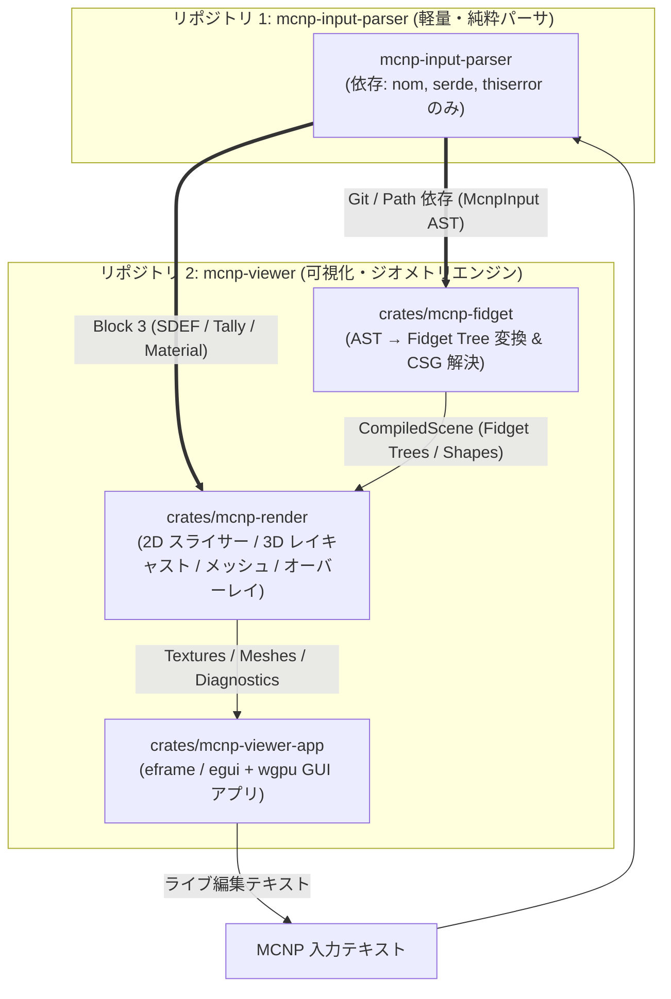
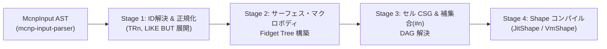
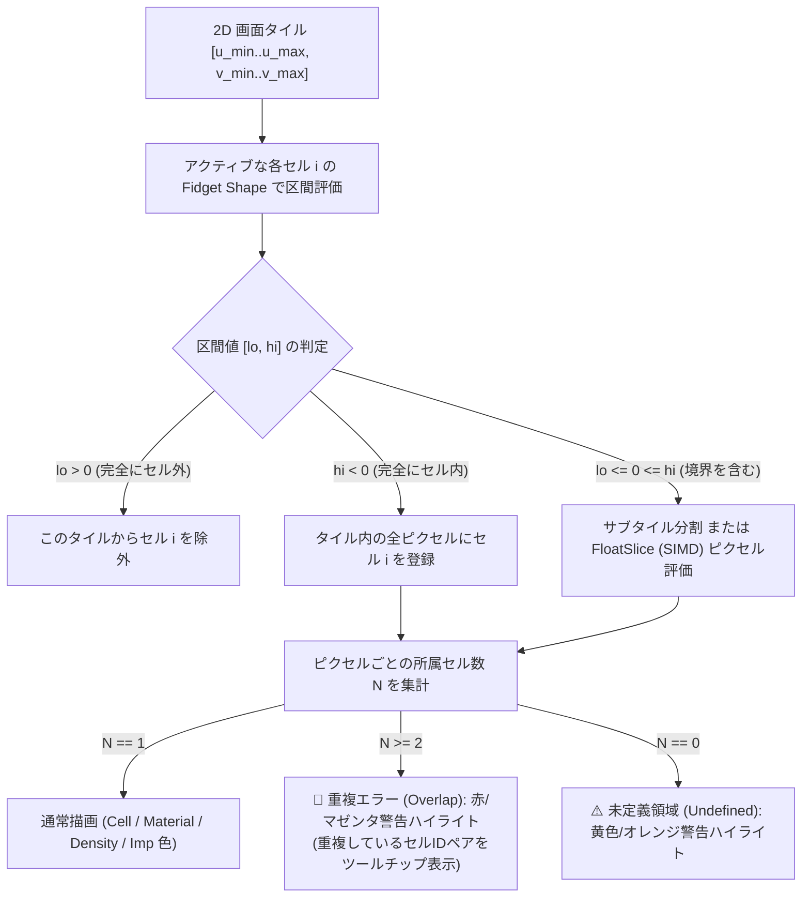
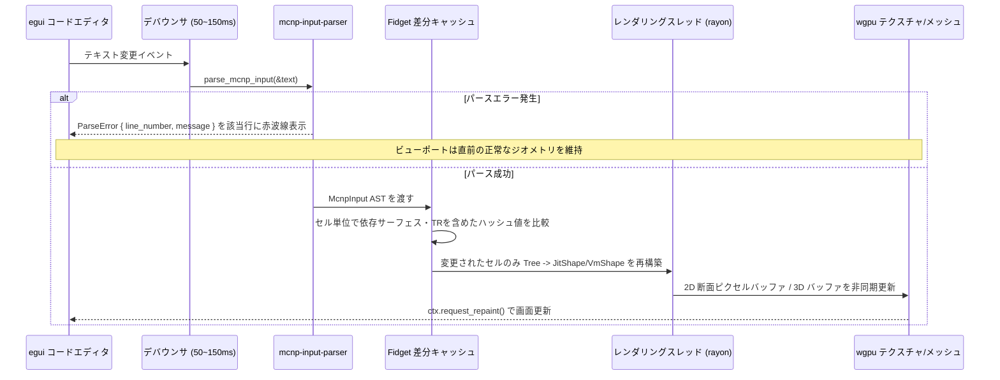

# MCNP ジオメトリ・入力可視化アプリケーション設計書 (`mcnp-viewer`)

## 1. 概要と目的

本ドキュメントは、[`mcnp-input-parser`](file:///Users/shotaro/work/mcnp-input-parser/src/lib.rs) が生成する MCNP 入力ファイルの抽象構文木（[`McnpInput`](file:///Users/shotaro/work/mcnp-input-parser/src/ast.rs#L5-L16)）を入力とし、陰関数（Implicit Surface）評価ライブラリ **[`mkeeter/fidget`](https://github.com/mkeeter/fidget)** をジオメトリエンジンとして用いて MCNP の体系・線源・タリーをインタラクティブに可視化するアプリケーションの設計書である。

### 1.1 なぜ `mcnp-input-parser` × `fidget` なのか

MCNP のジオメトリは **CSG（Constructive Solid Geometry：構成的立体幾何）** で記述される。すべてのサーフェス（平面、球、円柱、円錐、二次曲面、トーラス、マクロボディ）は「空間座標 $(x, y, z)$ に対する代数関数 $f(x, y, z) \lessgtr 0$ の半空間（Half-space）」として定義され、セルはそれらの積集合（Intersection）、和集合（Union）、補集合（Complement）で表現される。

`mkeeter/fidget` は、閉じた数式ツリー $f(x, y, z) \le 0$ を高速評価するために設計された Rust 製ライブラリであり、MCNP の CSG 体系と数学的に **1対1で対応** する。

| MCNP の概念 | `mcnp-input-parser` AST | `fidget` における表現 |
| :--- | :--- | :--- |
| サーフェス方程式 $S(x,y,z) = 0$ | [`SurfaceCard`](file:///Users/shotaro/work/mcnp-input-parser/src/ast.rs#L141-L148) / [`SurfaceKind`](file:///Users/shotaro/work/mcnp-input-parser/src/ast.rs#L152-L202) | `fidget::context::Tree` による代数式 $f(x,y,z)$ |
| サーフェスセンス（`-S` / `+S`） | [`GeometryExpr::Surface(i32)`](file:///Users/shotaro/work/mcnp-input-parser/src/ast.rs#L75) | `-S`（負側）$\implies +f(x,y,z) \le 0$<br>`+S`（正側）$\implies -f(x,y,z) \le 0$ |
| 積集合（空白区切り `A B`） | [`GeometryExpr::Intersection`](file:///Users/shotaro/work/mcnp-input-parser/src/ast.rs#L83) | $\max(f_A, f_B)$ (`a.max(b)`) |
| 和集合（`:` 区切り `A : B`） | [`GeometryExpr::Union`](file:///Users/shotaro/work/mcnp-input-parser/src/ast.rs#L85) | $\min(f_A, f_B)$ (`a.min(b)`) |
| 補集合（`#n` / `#(...)`） | [`GeometryExpr::Complement`](file:///Users/shotaro/work/mcnp-input-parser/src/ast.rs#L79-L81) | $-f_A$ (`-a`) |
| 座標変換（`TRn` / `TRCL`） | [`DataCard::Transform`](file:///Users/shotaro/work/mcnp-input-parser/src/ast.rs#L726-L730) / [`CellParam::Transformation`](file:///Users/shotaro/work/mcnp-input-parser/src/ast.rs#L114-L117) | `tree.remap_xyz(x', y', z')` による逆アフィン変換 |

Fidget の **区間演算（Interval Arithmetic）による空間枝刈り** と **テープ簡約（Tape Simplification）＋ JIT コンパイル（ネイティブ `aarch64`/`x86_64`）/ VM 実行（WASM）** を活用することで、従来のモンテカルロ・レイトレーシング方式よりも桁違いに高速な 2D 断面プロット・ジオメトリエラー（重複/未定義領域）検出・3D 描画を実現する。

---

## 2. システムアーキテクチャとマルチレポ構成

`eframe` / `egui` / `wgpu`（約300〜400クレート）や `fidget`（JIT・メッシュ生成）といった重量級の依存関係によって、`mcnp-input-parser` 本体の高速なビルド（約2秒）や `rust-analyzer` のコード解析パフォーマンスが損なわれるのを防ぐため、**マルチレポ（別リポジトリ）構成** を採用する。



### 2.1 リポジトリ分割と責務

| リポジトリ名 | ローカルパス想定 | 主な外部依存 | 特徴・責務 |
| :--- | :--- | :--- | :--- |
| **`mcnp-input-parser`**<br>（本リポジトリ） | `/Users/shotaro/work/mcnp-input-parser` | `nom`, `serde`, `serde_json`, `thiserror` | ・MCNP 入力の字句解析・前処理・構文木（[`McnpInput`](file:///Users/shotaro/work/mcnp-input-parser/src/ast.rs#L5-L16)）の生成に特化<br>・GUI や 3D 関連の依存を一切持たず、`cargo test` や `rust-analyzer` が常に数秒で動作する<br>・他の CLI ツールや解析スクリプトからも軽量ライブラリとして再利用可能 |
| **`mcnp-viewer`**<br>（新規リポジトリ） | `/Users/shotaro/work/mcnp-viewer` | `mcnp-input-parser`, `fidget`, `eframe`, `egui`, `wgpu`, `rayon` | ・`mcnp-input-parser` を外部クレートとして参照し、Fidget 数式ツリーへの変換および 2D/3D 可視化 GUI を提供<br>・内部は下記 2.2 の通り3つのサブクレートに分割し、リポジトリ内の再ビルド時間も最小化する |

### 2.2 新規リポジトリ (`mcnp-viewer`) 内部のディレクトリ構成

`mcnp-viewer` リポジトリ内でも、`wgpu` / `eframe` の再コンパイル・リンク負荷を抑えるため、変換コア（`mcnp-fidget`）・レンダラ（`mcnp-render`）・GUI（`mcnp-viewer-app`）にクレートを分離する。

```text
/Users/shotaro/work/
├── mcnp-input-parser/             # [既存リポジトリ] 純粋な MCNP パーサライブラリ
│   ├── Cargo.toml
│   └── src/
│
└── mcnp-viewer/                   # [新規リポジトリ] Fidget 可視化アプリケーション
    ├── Cargo.toml                 # Workspace ルート ([patch] 設定・最適化プロファイル定義)
    └── crates/
        ├── mcnp-fidget/           # AST → Fidget Tree 変換 (依存: mcnp-input-parser, fidget-core のみ)
        ├── mcnp-render/           # 2D/3D 評価・重複検出・メッシュ生成 (依存: fidget-jit, fidget-mesh, rayon)
        └── mcnp-viewer-app/       # GUI フロントエンド (依存: eframe, egui, wgpu, egui_plot)
```

### 2.3 マルチレポ間の連携・ローカル開発ワークフロー

マルチレポ構成において、「`mcnp-input-parser` の AST を少し修正して、すぐに `mcnp-viewer` 側で試したい」というケースをシームレスに行うため、Cargo の `[patch]` 機能または相対パス参照を活用する。

#### 1. `mcnp-viewer/Cargo.toml` における依存定義
通常は Git リポジトリ（またはローカル相対パス `../mcnp-input-parser`）を参照しつつ、ローカル開発時は `.cargo/config.toml` の `[patch]` でローカルの作業ツリーを直接向くように構成する。

```toml
# mcnp-viewer/Cargo.toml
[workspace]
resolver = "2"
members = [
    "crates/mcnp-fidget",
    "crates/mcnp-render",
    "crates/mcnp-viewer-app",
]
# 普段の `cargo test` では GPU 依存を持たない変換・描画コアのみを既定ターゲットにする
default-members = [
    "crates/mcnp-fidget",
    "crates/mcnp-render",
]

[workspace.dependencies]
# ローカル並列配置での開発時は path 指定、または git 指定 + .cargo/config.toml patch
mcnp-input-parser = { path = "../mcnp-input-parser" }
fidget = { version = "0.4", features = ["jit", "mesh"] }

# 外部クレート（fidget, wgpu, egui）は初回のみ opt-level = 2 でビルドして target/ にキャッシュ固定
# これによりデバッグ実行でも Fidget の断面評価が高速に動作し、2回目以降のビルドも数秒で完了する
[profile.dev.package."*"]
opt-level = 2
```

#### 2. IDE / エディタ（`rust-analyzer`）の分離運用
- パーサの文法拡張やバグ修正を行う際は、`mcnp-input-parser` ディレクトリ単体でエディタを開くことで、依存クレート4個のみの超軽量環境で開発できる。
- 可視化アプリを開発する際は、`mcnp-viewer` ディレクトリを開く。`mcnp-fidget` クレートは `fidget-core` と `mcnp-input-parser` のみに依存しているため、CSG 変換ロジックの単体テスト（`cargo test -p mcnp-fidget`）は `wgpu` を一切経由せず約 3〜5 秒で高速に実行できる。

---

## 3. MCNP AST から Fidget 数式ツリーへの変換設計 (`mcnp-fidget`)

`mcnp-input-parser` から受け取った [`McnpInput`](file:///Users/shotaro/work/mcnp-input-parser/src/ast.rs#L5-L16) を元に、各セルの陰関数ツリー `fidget::context::Tree` を構築するパイプラインは、以下の **4 ステージ** で構成される。



### 3.1 Stage 1: ID テーブル構築と正規化パス

1. **ID インデックス作成**:
   - `surfaces: HashMap<u32, &SurfaceCard>`
   - `cells: HashMap<u32, &CellCard>`
   - `transforms: HashMap<u32, AffineTransform>`（[`DataCard::Transform`](file:///Users/shotaro/work/mcnp-input-parser/src/ast.rs#L726-L730) から構築）
   - `materials: HashMap<u32, &DataCard>`（[`DataCard::Material`](file:///Users/shotaro/work/mcnp-input-parser/src/ast.rs#L574-L578) から構築）
   - Block 3 の [`DataCard::Importance`](file:///Users/shotaro/work/mcnp-input-parser/src/ast.rs#L672-L676) が存在する場合は、セル順序に沿って各セルの Importance 属性へマージする。
2. **`LIKE n BUT` の解決**:
   - [`CellDefinition::LikeBut { base_cell_id }`](file:///Users/shotaro/work/mcnp-input-parser/src/ast.rs#L66-L68) を持つセルについて、`base_cell_id` のジオメトリ式とパラメータを継承し、`params` 内の [`CellParam::Material`](file:///Users/shotaro/work/mcnp-input-parser/src/ast.rs#L112)、[`CellParam::Density`](file:///Users/shotaro/work/mcnp-input-parser/src/ast.rs#L110)、[`CellParam::Transformation`](file:///Users/shotaro/work/mcnp-input-parser/src/ast.rs#L114-L117)（`TRCL`）等でオーバーライドした正規化済みセル定義（`ResolvedCell`）を生成する。

### 3.2 Stage 2: サーフェスカード（`SurfaceKind`）の陰関数定義

Fidget では **`f(x, y, z) <= 0` が「内部（Inside）」** として扱われる。
一方、MCNP のサーフェス $S(x, y, z) = 0$ は、センス `-s` が $S(x, y, z) < 0$、センス `+s` が $S(x, y, z) > 0$ を意味する。したがって、各サーフェス ID $s$ について基準関数 $S_s(x, y, z)$ を以下のように定義すればよい。

- **センス `-s`（負のセンス）**: `tree = S_s(x, y, z)` （$S_s \le 0$ で内部）
- **センス `+s`（正のセンス）**: `tree = -S_s(x, y, z)` （$-S_s \le 0 \iff S_s \ge 0$ で内部）

#### 基本サーフェス（[`SurfaceKind`](file:///Users/shotaro/work/mcnp-input-parser/src/ast.rs#L152-L202)）の数式マッピング

3D レイキャスティングやメッシュ生成における数値安定性を高めるため、球や円柱などは二乗形式ではなくユークリッド距離形式（Signed Distance Function に近い形）に正規化して構築する。

| 種別 | [`SurfaceKind`](file:///Users/shotaro/work/mcnp-input-parser/src/ast.rs#L152-L202) | パラメータ (`params`) | 基準陰関数 $S(x, y, z)$ |
| :--- | :--- | :--- | :--- |
| 一般平面 | `P` | $A, B, C, D$ （または 3点座標 9個） | $\frac{Ax + By + Cz - D}{\sqrt{A^2 + B^2 + C^2}}$ ※3点指定時は法線と原点を算出（原点側が負センスになるようMCNP規約に従い符号決定） |
| 軸垂直平面 | `PX`, `PY`, `PZ` | $D$ | `PX`: $x - D$, `PY`: $y - D$, `PZ`: $z - D$ |
| 球 | `SO` | $R$ | $\sqrt{x^2 + y^2 + z^2} - R$ |
| 一般球 | `S` | $x_0, y_0, z_0, R$ | $\sqrt{(x-x_0)^2 + (y-y_0)^2 + (z-z_0)^2} - R$ |
| 軸上球 | `SX`, `SY`, `SZ` | $d_0, R$ | 例 `SX`: $\sqrt{(x-d_0)^2 + y^2 + z^2} - R$ |
| 軸上円柱 | `CX`, `CY`, `CZ` | $R$ | 例 `CZ`: $\sqrt{x^2 + y^2} - R$ |
| 平行円柱 | `C_X`, `C_Y`, `C_Z` | $d_1, d_2, R$ | 例 `C_Z`: $\sqrt{(x-x_0)^2 + (y-y_0)^2} - R$ |
| 軸上円錐 | `KX`, `KY`, `KZ` | $d_0, t^2, [\pm 1]$ | 例 `KZ`: $\sqrt{x^2 + y^2} - |t|(z - z_0)$ （単葉指定 $\pm 1$ がある場合は半空間制約を `max` で合成） |
| 平行円錐 | `K_X`, `K_Y`, `K_Z` | $x_0, y_0, z_0, t^2, [\pm 1]$ | 対応軸周りの円錐関数 |
| 軸平行二次曲面 | `SQ` | $A, B, C, D, E, F, G, x_0, y_0, z_0$ | $A(x-x_0)^2 + B(y-y_0)^2 + C(z-z_0)^2 + 2D(x-x_0) + 2E(y-y_0) + 2F(z-z_0) + G$ |
| 一般二次曲面 | `GQ` | $A, B, C, D, E, F, G, H, J, K$ | $Ax^2 + By^2 + Cz^2 + Dxy + Eyz + Fzx + Gx + Hy + Jz + K$ |
| トーラス | `TX`, `TY`, `TZ` | $x_0, y_0, z_0, A, B, C$ | 例 `TZ`: $\frac{(z-z_0)^2}{B^2} + \frac{(\sqrt{(x-x_0)^2 + (y-y_0)^2} - A)^2}{C^2} - 1$ |
| 軸対称曲面 | `X`, `Y`, `Z` | $(d_1, r_1), [(d_2, r_2), (d_3, r_3)]$ | 1点: 平面、2点: 線形補間（平面/円柱/円錐）、3点: 二次曲面へ変換 |

#### マクロボディとファセット（[`GeometryExpr::Facet`](file:///Users/shotaro/work/mcnp-input-parser/src/ast.rs#L77)）の展開

MCNP のマクロボディは、全体に対する参照（`-10` や `+10`）だけでなく、特定ファセット（面）に対する参照（`-10.1`, `+10.2` など）がセルカード内で使用される。
そのため、各マクロボディは **「構成ファセット平面/曲面の配列 `facets: Vec<Tree>`」** と **「マクロボディ全体の合成ツリー `whole_tree: Tree`」** の両方を生成して保持する。

| マクロボディ | パラメータ | ファセット展開と全体式（$\max$ = 積集合） |
| :--- | :--- | :--- |
| `RPP` | $x_{\min}, x_{\max}, y_{\min}, y_{\max}, z_{\min}, z_{\max}$ | Facet 1: $x - x_{\max}$, Facet 2: $x_{\min} - x$, Facet 3: $y - y_{\max}$, Facet 4: $y_{\min} - y$, Facet 5: $z - z_{\max}$, Facet 6: $z_{\min} - z$<br>全体: $\max_{i=1..6}(\text{Facet}_i)$ |
| `BOX` | $\mathbf{v}_0, \mathbf{a}_1, \mathbf{a}_2, \mathbf{a}_3$ | 直交3ベクトル $\mathbf{a}_1, \mathbf{a}_2, \mathbf{a}_3$ から6つの境界平面（Facet 1〜6）を生成し $\max$ で合成 |
| `SPH` | $x_0, y_0, z_0, R$ | `S` と同一（Facet 1 のみ） |
| `RCC` | $\mathbf{v}_0, \mathbf{h}, R$ | 軸方向単位ベクトル $\hat{\mathbf{h}} = \mathbf{h}/|\mathbf{h}|$, 長さ $L = |\mathbf{h}|$<br>Facet 1（側面円柱）: $|(\mathbf{p}-\mathbf{v}_0) - ((\mathbf{p}-\mathbf{v}_0)\cdot\hat{\mathbf{h}})\hat{\mathbf{h}}| - R$<br>Facet 2（上面）: $(\mathbf{p}-\mathbf{v}_0)\cdot\hat{\mathbf{h}} - L$<br>Facet 3（底面）: $-(\mathbf{p}-\mathbf{v}_0)\cdot\hat{\mathbf{h}}$ |
| `RHP` / `HEX` | $\mathbf{v}_0, \mathbf{h}, \mathbf{r}_1, [\mathbf{r}_2, \mathbf{r}_3]$ | 6つの側面（Facet 1〜6）＋ 上面（Facet 7）＋ 底面（Facet 8）の8半空間の $\max$ |
| `REC` | $\mathbf{v}_0, \mathbf{h}, \mathbf{v}_1, \mathbf{v}_2$ | 楕円柱側面（Facet 1）＋ 上面（Facet 2）＋ 底面（Facet 3） |
| `TRC` | $\mathbf{v}_0, \mathbf{h}, R_1, R_2$ | 円錐台側面（Facet 1）＋ 上面（Facet 2）＋ 底面（Facet 3） |
| `ELL` | $\mathbf{v}_1, \mathbf{v}_2, R_m$ | $R_m > 0$（2焦点＋長軸長）または $R_m < 0$（中心＋長軸ベクトル＋短軸長）から回転楕円体を構築 |
| `WED` | $\mathbf{v}_0, \mathbf{v}_1, \mathbf{v}_2, \mathbf{v}_3$ | 三角柱（楔形）の5平面（Facet 1〜5）の $\max$ |
| `ARB` | 8頂点 + 4桁面定義×6 | 指定された4〜6面の外向き法線平面の $\max$ |

### 3.3 Stage 3: セル CSG ツリーと補集合（`#n`）の構築

[`GeometryExpr`](file:///Users/shotaro/work/mcnp-input-parser/src/ast.rs#L73-L86) を再帰的に走査し、`fidget::context::Tree` へ変換する。

```rust
pub fn compile_geometry_expr(
    expr: &GeometryExpr,
    surfaces: &HashMap<u32, CompiledSurface>,
    cell_ast_map: &HashMap<u32, &CellCard>,
    visiting_cells: &mut HashSet<u32>, // 循環参照 (#1 -> #2 -> #1) 検出用
) -> Result<Tree, GeometryCompileError> {
    match expr {
        GeometryExpr::Surface(signed_id) => {
            let id = signed_id.unsigned_abs();
            let surf = surfaces.get(&id).ok_or(GeometryCompileError::UndefinedSurface(id))?;
            if *signed_id < 0 {
                Ok(surf.whole_tree.clone())
            } else {
                Ok(-surf.whole_tree.clone())
            }
        }
        GeometryExpr::Facet { surface, facet } => {
            let id = surface.unsigned_abs();
            let surf = surfaces.get(&id).ok_or(GeometryCompileError::UndefinedSurface(id))?;
            let f_tree = surf.facets.get((*facet as usize).wrapping_sub(1))
                .ok_or(GeometryCompileError::InvalidFacet { surface: id, facet: *facet })?;
            if *surface < 0 {
                Ok(f_tree.clone())
            } else {
                Ok(-f_tree.clone())
            }
        }
        GeometryExpr::Complement(inner) => {
            let t = compile_geometry_expr(inner, surfaces, cell_ast_map, visiting_cells)?;
            Ok(-t)
        }
        GeometryExpr::ComplementCell(target_cell_id) => {
            if !visiting_cells.insert(*target_cell_id) {
                return Err(GeometryCompileError::ComplementCycle(*target_cell_id));
            }
            let target_tree = compile_cell_tree(*target_cell_id, surfaces, cell_ast_map, visiting_cells)?;
            visiting_cells.remove(target_cell_id);
            Ok(-target_tree)
        }
        GeometryExpr::Intersection(terms) => {
            let mut iter = terms.iter();
            let first = compile_geometry_expr(iter.next().unwrap(), surfaces, cell_ast_map, visiting_cells)?;
            iter.try_fold(first, |acc, term| {
                Ok(acc.max(compile_geometry_expr(term, surfaces, cell_ast_map, visiting_cells)?))
            })
        }
        GeometryExpr::Union(terms) => {
            let mut iter = terms.iter();
            let first = compile_geometry_expr(iter.next().unwrap(), surfaces, cell_ast_map, visiting_cells)?;
            iter.try_fold(first, |acc, term| {
                Ok(acc.min(compile_geometry_expr(term, surfaces, cell_ast_map, visiting_cells)?))
            })
        }
    }
}
```

### 3.4 座標変換（`TRn` / `TRCL`）の適用

MCNP の座標変換カード（[`DataCard::Transform`](file:///Users/shotaro/work/mcnp-input-parser/src/ast.rs#L726-L730)）およびセルパラメータ（[`CellParam::Transformation`](file:///Users/shotaro/work/mcnp-input-parser/src/ast.rs#L114-L117)）は、補助座標系 $(x', y', z')$ から主座標系 $(x, y, z)$ への変換を定義する：
$$\mathbf{p} = \mathbf{O} + B^T \mathbf{p}' \iff \mathbf{p}' = B (\mathbf{p} - \mathbf{O})$$

- `is_degrees = true`（`*TRn` または `*TRCL`）の場合は、入力された角度 $\theta_{ij} \in [0, 180]$ に $\cos(\theta_{ij} \cdot \pi / 180)$ を適用して方向余弦行列 $B$ に変換する。
- MCNP の省略記法（3要素＝平行移動のみ、6要素＝1行＋1列、9要素＝完全3×3行列）に対応し、欠損している行ベクトルは外積および正規直交化によって補完する。
- Fidget の `Tree::remap_xyz(x_prime, y_prime, z_prime)` メソッドを用い、サーフェスまたはセルの `Tree` に対して逆変換式を合成する。

### 3.5 Universe / Lattice（`U`, `FILL`, `LAT=1`, `LAT=2`）の段階的拡張設計

Phase 1〜4 で基本 CSG を完成させた後、Phase 5 にて以下のアプローチで階層構造（Universe / Lattice）をサポートする。

1. **単一 Universe 充填（`FILL=u`）**:
   - 親セル $P$ の領域ツリーを $T_P$、充填される Universe $u$ に属する子セル $C_i$ のツリーを $T_{C_i}$（`FILL=u (TR)` 指定時は逆アフィン変換適用後）とすると、ワールド空間における実効セル領域は単純な積集合 $\max(T_P, T_{C_i})$ として単一の Fidget `Tree` にフラット化できる。
2. **格子体系（`LAT=1` 六面体格子 / `LAT=2` 六角柱格子）**:
   - **一様充填格子**: `Tree` 内で座標 $(x, y, z)$ に対して周期関数（モジュロ演算 `rem_euclid` 相当ののこぎり波式）を合成することで、数千本の燃料ピン格子であっても **O(1) の数式サイズ** で Fidget による超高速評価が可能。
   - **非一様（要素別 Universe 配列）充填格子**: 2D/3D レンダラの空間タイル評価時に、現在の空間座標 $(x, y, z)$ から格子インデックス $(i, j, k)$ を逆算し、対応する Universe $u(i,j,k)$ のコンパイル済み `Shape` にディスパッチするハイブリッド評価器を採用する。

---

## 4. マルチセル評価とレンダリング設計 (`mcnp-render`)

### 4.1 マルチセル評価と「ジオメトリ重複・未定義領域」の自動検出

MCNP 入力作成において最も頻発するバグは **「セルの重複（Overlap：複数のセルが同じ空間を占有）」** と **「未定義領域（Undefined Region / Lost Particle：どのセルにも属さない隙間）」** である。
従来の MCNP プロッタでも破線で警告されるが、Fidget の区間演算タイル評価を使うことで、画面全体の重複・未定義領域を瞬時にピクセル単位で検出・可視化できる。



- **ネイティブ実行時 (`cfg(not(target_arch = "wasm32"))`)**: `fidget::jit::JitShape` を使用し、CPU ネイティブ機械語（SIMD）で各セルのタイル評価を `rayon` によりマルチスレッド並列実行する。
- **WASM 実行時 (`cfg(target_arch = "wasm32")`)**: `fidget::vm::VmShape` に自動フォールバックする（Fidget の `Shape` トレイト抽象化によりレンダリングコードは完全に共通化される）。

### 4.2 2D 任意断面スライサー（MCNP `IP` プロッタの上位互換）

任意の断面平面は、3次元空間上の中心点 $\mathbf{O}$、画面横方向単位ベクトル $\mathbf{u}$、画面縦方向単位ベクトル $\mathbf{v}$、および表示幅 $W$ で定義される：
$$\mathbf{p}(u, v) = \mathbf{O} + u \mathbf{u} + v \mathbf{v}$$

1. **2D スライス木の生成**:
   - 各セルの 3D `Tree` に対し、`tree.remap_xyz(O.x + X * u.x + Y * v.x, O.y + X * u.y + Y * v.y, O.z + X * u.z + Y * v.z)` を適用することで、Fidget の 2D 評価器（$X, Y$ の 2 変数のみに依存）へ変換する。
   - Fidget のテープ簡約（Tape Simplification）により、断面と平行な定数項（例：$Z = z_0$ 断面における `PZ` 平面など）はコンパイル時に定数畳み込みされ、評価コストが最小化される。
2. **カラーマッピングモード**:
   - **Cell ID モード**: セル ID ごとに視認性の高いパステル/カテゴリカルカラーを割り当て（Void セル `mat=0` は背景色または透過）。
   - **Material ID モード**: `material_id` ごとに色分け。同じ材質を持つ複数セルが同一色で表示される。
   - **Density（密度）モード**: 質量密度 $\rho \ [\text{g/cm}^3]$ または原子数密度 $[\text{atoms/b}\cdot\text{cm}]$ をカラーマップ（Viridis / Plasma）で連続表示。
   - **Importance モード**: 指定粒子（`n`, `p`, `e` 等）に対する `IMP` 値を対数カラースケール（ヒートマップ）で表示。`IMP=0`（粒子消滅領域）は斜線ハッチングまたは暗灰色で明示。
   - **Temperature モード**: `TMP` パラメータ $[\text{MeV}]$ または $[\text{K}]$ によるヒートマップ表示。
3. **境界線（コンター）描画**:
   - 隣接ピクセル間のセル ID 変化、または各サーフェス関数の符号反転エッジを検出し、アンチエイリアス付きの境界線を描画する。
   - [`BoundaryCondition::Reflective`](file:///Users/shotaro/work/mcnp-input-parser/src/ast.rs#L135)（`*` 反射境界）は太い破線、[`BoundaryCondition::White`](file:///Users/shotaro/work/mcnp-input-parser/src/ast.rs#L137)（`+` 白色境界）は点線で区別して描画する。
4. **インタラクティブ操作**:
   - マウスドラッグによるパン、ホイールによるズーム（カーソル中心）、スライダーまたは数値入力による断面位置オフセット移動、マウスホバーによるリアルタイム座標・セルID・材質・密度・核種組成のポップアップ表示。

### 4.3 3D レンダリングとメッシュ生成

3D ビューポートでは、用途に応じて以下の **2 つのレンダリングモード** を切り替え可能とする。

| モード | 使用する Fidget API | 特徴・用途 |
| :--- | :--- | :--- |
| **1. 高速 SDF レイキャストモード** | `fidget::render::render3d` | メッシュ生成待ち時間ゼロで即座に 3D 形状を確認可能。カメラ視点からの八分木（Octree）レイキャスティングにより深度マップと法線マップを直接生成し、`wgpu` シェーダで陰影付けして表示する。**任意のカットアウェイ断面（例：$X>0 \land Y>0$ の 1/4 カットモデル）** を `max(cell_tree, clip_tree)` で瞬時に合成できる。 |
| **2. ポリゴンメッシュモード** | `fidget::mesh::Octree::build` + `walk_dual` | **Manifold Dual Contouring** により、円柱や直方体のシャープエッジを保ったまま各セルの閉多様体（Watertight）三角形メッシュをバックグラウンド生成する。一度生成すれば `wgpu` 上で 60fps の滑らかな回転・半透明材質表示・ワイヤーフレーム重ね合わせが可能。また **STL / OBJ / glTF エクスポート** にも対応する。 |

---

## 5. 線源・タリー・メッシュのオーバーレイ可視化設計

[`McnpInput::data_cards`](file:///Users/shotaro/work/mcnp-input-parser/src/ast.rs#L15)（Block 3）から空間情報を持つカードを抽出し、2D 断面および 3D ビューポート上にジオメトリと重ねて描画（オーバーレイ）する。

### 5.1 線源定義の可視化（`SDEF`, `KSRC`, `SI`/`SP`）

1. **臨界初期線源（[`DataCard::Ksrc`](file:///Users/shotaro/work/mcnp-input-parser/src/ast.rs#L749-L751)）**:
   - `points: Vec<[f64; 3]>` の各座標を 3D 空間上の発光マーカー（2D 断面では近傍点の投影マーカー）として描画する。
2. **固定線源（[`DataCard::Sdef`](file:///Users/shotaro/work/mcnp-input-parser/src/ast.rs#L590-L593) + [`SiCard`](file:///Users/shotaro/work/mcnp-input-parser/src/ast.rs#L366-L370) / [`SpSbCard`](file:///Users/shotaro/work/mcnp-input-parser/src/ast.rs#L398-L403)）**:
   - **解析的線源形状の表示**:
     - `POS`（基準位置）、`AXS`（軸ベクトル）、`RAD`（半径分布 `SI` の最小〜最大値）、`EXT`（軸方向広がり `SI` の範囲）、`X`, `Y`, `Z`（直方体範囲）を解析し、線源領域（点、球殻、円柱、直方体）を半透明ワイヤーフレームまたは Fidget の補助 `Tree` として可視化する。
     - `VEC` および `DIR` が指定されている場合は、放出方向コーン（矢印）を描画する。
   - **モンテカルロ・サンプリングプレビュー**:
     - `SDEF` と参照先の `SI`/`SP` 分布からアプリ内で軽量な乱数サンプリング（例：1,000〜10,000 点）を実行し、発生位置と放出方向のベクトル群を点群・矢印としてプロットする（複雑な従属分布 `DS` や複数セル線源の確認に極めて有効）。

### 5.2 タリー・メッシュの可視化（`F5`, `FMESH`, `F1`/`F2`/`F4`）

1. **ポイント / リング検出器タリー（[`DataCard::DetectorTally`](file:///Users/shotaro/work/mcnp-input-parser/src/ast.rs#L618-L625)）**:
   - [`DetectorEntry::Point { x, y, z, r0 }`](file:///Users/shotaro/work/mcnp-input-parser/src/ast.rs#L482): 座標 $(x, y, z)$ に検出器アイコンと、排除球半径 $R_0$ の球面（2D では円）を描画する。
   - [`DetectorEntry::Ring { axis, axis_coord, radius, r0 }`](file:///Users/shotaro/work/mcnp-input-parser/src/ast.rs#L484-L490): 指定軸上の位置 `axis_coord`、半径 `radius`、断面半径 $R_0$ のトーラス（リング）を描画する。
2. **重ね合わせメッシュタリー（[`DataCard::Fmesh`](file:///Users/shotaro/work/mcnp-input-parser/src/ast.rs#L669) / [`FmeshCard`](file:///Users/shotaro/work/mcnp-input-parser/src/ast.rs#L536-L556)）**:
   - `origin`（省略時は $(0,0,0)$）、`imesh`/`iints`、`jmesh`/`jints`、`kmesh`/`kints` から直交（`geom=xyz`）または円筒（`geom=cyl`）の細分化メッシュグリッド座標を計算し、2D 断面上に半透明グリッド線を、3D ビュー上にバウンディングボックスと分割面を描画する。
3. **セル・サーフェスタリー（[`DataCard::Tally`](file:///Users/shotaro/work/mcnp-input-parser/src/ast.rs#L608-L616)）のハイライト**:
   - UI のタリー一覧から `F4` や `F2` タリーを選択した際、[`TallyTarget`](file:///Users/shotaro/work/mcnp-input-parser/src/ast.rs#L470-L477) に含まれるセルやサーフェス（および [`DataCard::TallySegment`](file:///Users/shotaro/work/mcnp-input-parser/src/ast.rs#L631-L635) `FSn` の分割面）を 2D/3D ビュー上で強調ハイライトする。

---

## 6. GUI・ライブエディタ連動設計 (`mcnp-viewer-app`)

### 6.1 画面レイアウト構成 (`eframe` / `egui_dock`)

```text
+--------------------------------------------------------------------------------------------------+
| [File: Open / Save / Export STL, PNG]  [View: 2D / 3D / Quad]  [Color: Material v]  [Check: ON]  |
+---------------------------+------------------------------------------+---------------------------+
| 1. ライブ入力エディタ      | 2. メインビューポート (2D / 3D / 4分割)   | 3. インスペクタ & 制御    |
| (行番号・構文ハイライト)   | +------------------+-------------------+ | [Slice Controls]          |
|                           | |   XY Plane (Z=0) |   XZ Plane (Y=0)  | |  Plane: [XY] [YZ] [XZ]    |
| 1  1 -1.0  -1   imp:n=1   | |     +------+     |     |      |      | |  Z offset: [===O===] 0.0  |
| 2  2 -2.0   1 -2 imp:n=1  | |    /  (1)   \    |     | (1)  |      | |  Bounds: [-50, 50] cm     |
| 3  0        2 -10         | |    \        /    |     |      |      | +---------------------------+
|                           | +------------------+-------------------+ | [Overlays]                |
| 1  cz 0.5                 | |   YZ Plane (X=0) |    3D Viewport    | |  [x] SDEF / KSRC Sources  |
| 2  cz 1.0                 | |                  |    (Raycast/Mesh) | |  [x] F5 Detectors         |
| *10 rpp -2 2 -2 2 -10 10  | |                  |      /-----\      | |  [x] FMESH14 Grid         |
|                           | |                  |      |  |  |      | |  [x] Overlap / Void Check |
| +-----------------------+ | +------------------+-------------------+ +---------------------------+
| | AST ツリー / 診断一覧 | | [Hover Info] Pos: (0.25, -0.10, 0.00)    | [Material / Spectrum Plot]|
| | ✅ Errors: 0          | | Cell: #1 | Mat: m1 (rho=-1.0) | Imp:n=1  |  m1: H-1 (67%), O-16 (33%)|
| | ⚠️ Overlap: Cell 1, 2 | +------------------------------------------+  SI3/SP3 Energy Spectrum  |
+---------------------------+------------------------------------------+---------------------------+
```

### 6.2 ライブプレビューと差分キャッシュ（Incremental Compilation）

ユーザーが左ペインのエディタで数値を書き換えた際（例：円柱半径 `1 cz 0.5` → `1 cz 0.8`）、画面が即座に追従して更新される体験を実現する。



- **セル単位の AST ハッシュキャッシュ**:
  - 各セルのコンパイル済み `Shape` は、`Hash(CellCard, 参照する SurfaceCard 群, 参照する TransformCard, 補集合で参照する CellCard 群)` をキーとしてキャッシュする。
  - これにより、1,000 セル規模の体系で 1 つのセルやサーフェスを編集した際も、影響を受ける数セルの Fidget `Shape` のみを数ミリ秒で再コンパイルできる。
- **マルチ解像度プログレッシブ描画**:
  - スライダーで断面位置をドラッグしている最中や 3D カメラ回転中は、低解像度（例：1/4 解像度）で即座にフレームを描画し、操作が止まった瞬間にフル解像度（アンチエイリアス・境界線・重複検出付き）をバックグラウンド完了させる。

---

## 7. `mcnp-input-parser` リポジトリ側への事前拡張仕様

マルチレポ構成において、`mcnp-viewer` から `mcnp-input-parser` を利用する際に必要となる小規模・非破壊の API 拡張（依存クレートの追加はゼロ）を以下に定義する。

1. **AST ノードへの `Hash` derive または行番号情報の付与**:
   - [`preprocess_mcnp`](file:///Users/shotaro/work/mcnp-input-parser/src/preprocess.rs) の `LogicalCard` が保持している `line_number: usize` を、必要に応じて [`CellCard`](file:///Users/shotaro/work/mcnp-input-parser/src/ast.rs#L49-L53) / [`SurfaceCard`](file:///Users/shotaro/work/mcnp-input-parser/src/ast.rs#L141-L148) から参照できるようにする（または行番号マップ付きのパース関数 `parse_mcnp_input_with_spans` を追加する）。
   - これにより、既存の [`CellCard`](file:///Users/shotaro/work/mcnp-input-parser/src/ast.rs#L49-L53) の構造体フィールドや既存テストを一切壊すことなく、**「2D/3D ビューポート上でセルをクリック $\implies$ エディタの該当セル定義行へジャンプ」** が実現できる。
2. **部分リカバリパース関数 (`parse_mcnp_input_lossy`) の提供**:
   - ライブ編集中に 1 つのカードが構文エラーになっても、正常にパースできた残りのカード群（`McnpInput`）とエラー一覧（`Vec<ParseError>`）を同時に返す API を追加する。

---

## 8. 段階的実装ロードマップ

### Phase 1: リポジトリ作成 & コア変換エンジン (`mcnp-fidget`) の構築
- `mcnp-input-parser` 側に `parse_mcnp_input_lossy`（および行番号マッピング）を追加。
- 別リポジトリ `/Users/shotaro/work/mcnp-viewer` を新規作成し、`crates/mcnp-fidget` をセットアップ。
- 基本サーフェス（`P`, `PX`, `PY`, `PZ`, `SO`, `S`, `SX`, `SY`, `SZ`, `CX`, `CY`, `CZ`, `C_X`, `C_Y`, `C_Z`, `KX`, `KY`, `KZ`, `K_X`, `K_Y`, `K_Z`, `SQ`, `GQ`, `TX`, `TY`, `TZ`, `X`, `Y`, `Z`）の Fidget `Tree` 変換実装と単体テスト。
- マクロボディ（`RPP`, `BOX`, `SPH`, `RCC`, `RHP`/`HEX`, `REC`, `TRC`, `ELL`, `WED`, `ARB`）およびファセット指定（`±s.f`）の展開実装。
- セル CSG 式（`Intersection`, `Union`, `Complement`, `ComplementCell` `#n`）と `LIKE n BUT`、座標変換（`TRn`, `TRCL`）の解決パス実装。

### Phase 2: 2D 断面スライサー & 重複/未定義領域チェッカー (`mcnp-render` & `mcnp-viewer-app` MVP)
- `eframe` / `egui` + `wgpu` によるウィンドウ立ち上げと MCNP ファイル読み込み。
- Fidget 2D タイル評価器による XY / YZ / XZ / 任意平面の高速スライス描画。
- Cell ID / Material ID / 密度 / Importance 別のカラーマッピングと境界線（反射境界 `*` 破線含む）描画。
- マウスホバーによるセル・材質・座標インスペクタ、およびジオメトリ重複（Overlap）・未定義領域（Undefined）のハイライト表示。

### Phase 3: ライブエディタ連動 & Block 3（線源・タリー）オーバーレイ
- 左ペインへの MCNP コードエディタ組み込み、セル単位の差分 `Shape` キャッシュ、エラー行ハイライト、ビューポートクリックからの行ジャンプ。
- `SDEF` / `KSRC` 線源位置・形状およびサンプリングプレビューのオーバーレイ表示。
- `F5` 検出器、`FMESH` グリッド、選択タリー対象セルのハイライト表示。
- `egui_plot` を用いた `SI`/`SP` 線源エネルギースペクトルおよび `DE`/`DF` 線量換算係数のグラフ表示。

### Phase 4: 3D レンダリング & メッシュエクスポート
- `fidget::render::render3d` による 3D Octree レイキャスティングビューポートとインタラクティブ・カットアウェイ（断面カット）機能。
- `fidget::mesh::Octree`（Manifold Dual Contouring）によるセル別 3D メッシュのバックグラウンド生成、`wgpu` 半透明 3D 表示、および STL / OBJ / glTF エクスポート機能。

### Phase 5: Universe / Lattice 拡張 & WebAssembly 対応
- `U` / `FILL` / `LAT=1`（六面体格子）/ `LAT=2`（六角柱格子）の評価サポート。
- `wasm32-unknown-unknown` ビルド対応（`VmShape` バックエンド + WebGPU / WebGL2）によるブラウザ上でのスタンドアロン動作。
